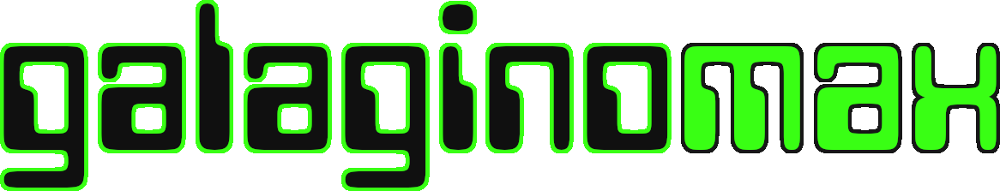
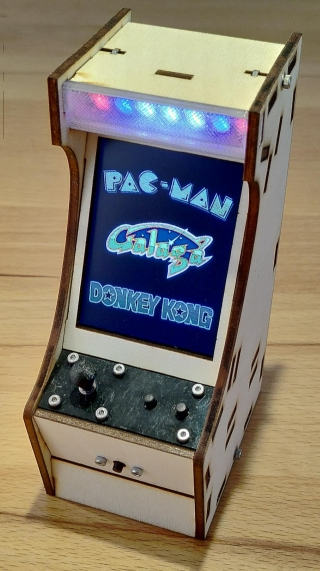

Arcade emulator for the ESP32 with a 240x320 SPI display. Fork of Galagino, now with **125+ games**.

Using compression, galagino**max** can **squeeze up to 101 games into the classic ESP-WROOM-32's 4 MB 
of flash**. You can also **have all 125+ games in flash, with some ROMs downloaded to the ESP32 on demand**. No need to upgrade to the S3!

* **New platforms and games:**
  * Atari DVG/AVG vector machines: Asteroids, Star Wars, Battle Zone, Lunar Lander, Tempest, Space Duel, Gravitar,
     Major Havoc, Black Widow
  * More Atari classics: Centipede, Missile Command, Tetris, Millipede, Crystal Castles
  * Sega System 1 and 2: Pitfall II, Flicky, Wonder Boy, Mister Viking, Up'n Down, Star Jacker,
    Choplifter
  * Williams: Defender, Robotron, Joust, Sinistar
  * Midway MCR: Tron, Discs of Tron, Tapper, Satan's Hollow
  * Gottlieb: Q*bert, Krull, Tylz
  * Data East DECO Cassette: Boulder Dash
  * Bally Astrocade: Gorf
  * **more highlights:** Contra, Zaxxon, Bubble Bobble, 1943, Ghosts'n Goblins, Commando, Mario Bros., Moon Patrol, Arkanoid, Green Beret, Track & Field, Yie Ar Kung-Fu.
* **Bonus: native ports** of Marble Madness (arcade) and H.E.R.O. (Atari 2600) run as C++ rewrites with
  graphics and levels from the original ROM.
* **New CPUs:** Intel 8088 (Q*bert), Fujitsu MB88xx (Namco 54xx sound MCU).
* **New sound hardware:** POKEY, TMS5220, S14001A, Votrax SC-01, VLM5030, YM2203 FM, Astrocade,
  Exidy 6840, HC-55516 CVSD. C64 SID music for games whose arcade sound is not emulated.
* **Smoother video:** smoother scrolling and less sprite wobble. Wide playfields pan with the
  player (Mario Bros., Marble Madness, Solomon's Key, Motoracer USA).
* **Performance optimizations** so heavy games reach 60 Hz.
* Bootup "self-test", FPS display, rotating cylinder menu added.
* **Fast, portable ROM conversion.** Converts games in parallel and uses 
  [uv](https://docs.astral.sh/uv/) to ease the setup.



## Prior work and credits

This builds on a lot of other people's great work.

* [harbaum/galagino](https://github.com/harbaum/galagino) (Till Harbaum): the original ESP32
  arcade emulator. Galaga, Pac-Man, Donkey Kong, Frogger, Dig Dug, 1942 and the rest of the first
  games. Uses the Z80 core of [Marat Fayzullin](https://fms.komkon.org/).
* [speckhoiler/galagino](https://github.com/speckhoiler/galagino): PlatformIO port, the CYD in
  an Arcade Galaga Micro Player build.
* [galagino/galagino](https://github.com/galagino/galagino): the repo this fork started from.
  Moon Cresta, Scramble, Super Cobra. Bluetooth controller over I2C with several fire buttons, ESP32-S3 16 MB board with external DAC (ES8311), 240 px
  portrait and landscape-on-portrait games, Time Pilot sprite multiplexing, Gyruss drums, display
  flip/invert fixes, Linux ROM conversion scripts, game selection in `platformio.ini`.
* [Alby1970](https://github.com/Alby1970): Bombjack, Mr. Do!, Pengo, Donkey Kong Jr.,
  Donkey Kong 3, Star Force.
* [SurvivalHacking/galagino3](https://github.com/SurvivalHacking/galagino3): Gyruss, Lady Bug,
  Ms. Pac-Man, Time Pilot, Tutankham, Space Invaders, Galaxian, ESP32-2432S024 support.
* [SurvivalHacking/spinnerino](https://github.com/SurvivalHacking/spinnerino): Phoenix.
* [VirtualClaudioBoy/GalaginoPlus](https://github.com/VirtualClaudioBoy/GalaginoPlus): Pooyan,
  Donkey Kong 3 sound, 48 game build.
* [BaasPierre/GalaginoPlusXT](https://github.com/BaasPierre/GalaginoPlusXT): new games for
  GalaginoPlus: Pinball Action, Ghosts 'n Goblins, The Fairyland Story, Bubble Bobble, Moon Patrol,
  Arkanoid.
* [galagino/galagino-controller](https://github.com/galagino/galagino-controller): the
  Bluetooth controller, read over I2C.
* [FabGL](https://github.com/fdivitto/FabGL): i8086 core (MIT), basis of the 8088 core.
* [LZMA SDK](https://www.7-zip.org/sdk.html) (Igor Pavlov): decompression of ROM data.
* [MAME](https://www.mamedev.org/): the reference

## Hardware

Any ESP32 board with a 240x320 ILI9341 or ST7789 display, a speaker and a stick with one fire
button works. Pins and display type are set in `config_local.h` or `platformio.ini`.

Supported boards (`source/platformio.ini`, `[board_*]`):

| Board                     | Env prefix       | Notes                                              |
| ---                       | ---              | ---                                                |
| AZ-Delivery DevKit V4     | `azdelivery`     | Own wiring, ILI9341, pins in `config_local.h`      |
| CYD ESP32-2432S028R       | `cyd2432s028r`   | ILI9341, 40 MHz SPI                                |
| Freenove FNK0103F         | `fnk0103f`       | ILI9341, 40 MHz SPI                                |
| Freenove FNK0103B         | `fnk0103b`       | ST7789, 80 MHz SPI                                 |
| Freenove FNK0104 (S3)     | `fnk0104`        | ESP32-S3, 16 MB flash, ES8311 DAC, all games built in |

Env names are `<board>-<mode>[-usbup]`. Modes: `local` (built-in games), `max` (100+ games at once), `remote` (flash + WiFi download), `full` (16 MB, everything in flash). `usbup` flips the display for a board mounted with the USB connector up.

Builds and sources:

* Original build with PCB: [harbaum/galagino](https://github.com/harbaum/galagino).
* 3D printed build by John Bradnam (this is my build. I recommend to soldier the cables to avoid 
  contact problems): [hackster.io](https://www.hackster.io/john-bradnam/galagino-esp32-arcade-355dde).
* 3D printed Cheap Yellow Display (CYD) cabinet by Gavin Knight:
  [hackster.io](https://www.hackster.io/dynamight/cyd-galagino-arcade-cabinet-369ce9).
* Galagino CYD based handheld: [hackster.io](https://www.hackster.io/dynamight/cyd-galagino-handheld-7c796c)
*  CYD in an Arcade Galaga Micro Player:
  [speckhoiler/galagino](https://github.com/speckhoiler/galagino) README, with schematics.
* Freenove boards: [Freenove_ESP32_Display](https://github.com/Freenove/Freenove_ESP32_Display),
  [Freenove_ESP32_S3_Display](https://github.com/Freenove/Freenove_ESP32_S3_Display).

## Build and Configuration

Needs [PlatformIO](https://platformio.org/) and [uv](https://docs.astral.sh/uv/).

1. Put the ROM zips and optional SID files into [romszip/](romszip/) (see [ROMs](#roms)).
2. Convert them: `romconv/convert.sh` (`romconv/convert.bat` on Windows). Pass game names to
   convert only those. See [romconv/README.md](romconv/README.md).
3. Build and flash from `source/`:

   ```sh
   make envs                      # list envs
   make azdelivery-max            # build, upload, open serial monitor
   make build ENV=fnk0103f-local  # build only
   ```

   Or `pio run -e <env> -t upload` or call `PlatformIO` bypassing `make`.

A game is built in with a `-D ENABLE_<GAME>` flag. `source/platformio.ini` groups the flags in
lists, and each mode picks lists (`[mode_*]`):

| List                  | Games | Used by                                                       |
| ---                   | ---   | ---                                                           |
| `[games] builtin`     | 40    | All modes except `max`. In `remote` these are the only games in flash |
| `[games] local`       | 35    | `local` and `full`. Downloaded in `remote`                    |
| `[games] rest`        | 49    | `full` only (16 MB flash). Downloaded in `remote`             |
| `[games_max] list`    | 101   | `max` only. Overlaps the lists above, smallest games first    |

Modes: `local` = builtin + local (75 games, 4 MB). `max` = the max list (4 MB). `full` = builtin +
local + rest (16 MB). `remote` = builtin in flash, local + rest downloaded.

To change the set, edit the lists. ROM-convert only the games you enable. Games that are not
converted cannot be built in.

### Local settings

Keep personal settings out of `config.h`. Put them in `source/src/config_local.h`. The file is
git-ignored and included first by `config.h`. Precedence: `platformio.ini` build flags, then
`config_local.h`, then `config.h` defaults.

Example `config_local.h`:

```c
#define MASTER_ATTRACT_GAME_TIMEOUT  60000 * 2
#define DEBUG_TIMING_FPS_HUD      // show emulation FPS at the bottom of the screen
#define GALAGINO_WIFI_SSID   "my-ssid"
#define GALAGINO_WIFI_PASS   "my-password"
#define LED_PIN           16
#define SND_RIGHT_CHANNEL         // audio on GPIO 25 instead of 26

// own pins: skip the board block in config.h
#define USE_PIO_CONFIG
#define TFT_CS            5
#define TFT_DC            32
// ... remaining TFT_* and BTN_* pins
```

### Defines

Set in `config_local.h` (`#define X`) or `platformio.ini` (`-D X`).

| Define                                | Default          | Effect                                                    |
| ---                                   | ---              | ---                                                       |
| `USE_PIO_CONFIG`                      | off              | Skip the board block of `config.h`, pins come from you    |
| `TFT_ILI9341`, `TFT_ST7789`           | ST7789           | Display controller                                        |
| `TFT_VFLIP`                           | off              | Display upside down                                       |
| `TFT_INVERT`                          | off              | CYD clones that show inverted colors                      |
| `TFT_SPICLK`                          | 40000000         | SPI clock. 40 MHz gives 30 Hz display, 80 MHz 60 Hz       |
| `LED_PIN`, `LED_BRIGHTNESS`           | off, 50          | WS2812 stripe, brightness 0..255                          |
| `SND_RIGHT_CHANNEL`                   | off              | Audio on GPIO 25 instead of 26                            |
| `SND_DIFF`                            | off              | Differential audio on GPIO 25 and 26                      |
| `NUNCHUCK_INPUT`                      | off              | Nunchuck input, emulation gets slower                     |
| `GALAGINO_CONTROLLER`                 | per board        | I2C controller with extra buttons                         |
| `ES8311_AUDIO`                        | per board        | External DAC (ESP32-S3)                                   |
| `MASTER_ATTRACT_MENU_TIMEOUT`         | 20000            | Idle time in menu before a game starts (ms)               |
| `MASTER_ATTRACT_GAME_TIMEOUT`         | 300000           | Time until an attract game ends (ms)                      |
| `MASTER_ATTRACT_MENU_SHOW_COUNTDOWN`  | on               | Countdown bar in the menu                                 |
| `MASTER_ATTRACT_MENU_COUNTDOWN_BAR_COLOR565` | `0x1234`  | Bar color, byte-swapped RGB565                            |
| `NO_DOWNLOADS_IN_ATTRACT`             | 1                | Remote builds: attract starts only cached games           |
| `SILENT_ATTRACT_MODE`                 | on in ini        | Demo sounds off                                           |
| `MENU_CYLINDER`                       | off              | Menu logos on a rotating drum                             |
| `BOOT_SELFTEST`                       | on in ini        | Arcade style boot screen, about 5 s                       |
| `DEBUG_TIMING_FPS_HUD`                | on in ini        | Emulation frame rate at the bottom of the screen          |
| `DEBUG_TIMING`                        | off              | Per-frame timing on serial                                |
| `MARIO_SCROLL`, `MARIO_SCALE`, `MARIO_CROP` | scroll     | Mario Bros.: fit 256 columns into 240                     |
| `BUBLBOBL_SCALE`, `_CROP`, `_SCALE_BORDER` | scale       | Bubble Bobble: fit 256 columns                            |
| `SOLOMON_SCALE`, `SOLOMON_SCROLL`     | crop             | Solomon's Key: fit the screen                             |
| `HERO_SCALE_Y`, `HERO_NTSC_COLORS`    | off              | H.E.R.O.: fill 288 rows, NTSC colors                      |
| `STARWARS_INVERT_Y`                   | off              | Star Wars: invert stick Y axis                            |
| `GALAGINO_WIFI_SSID`, `_PASS`, `GALAGINO_ASSETS_URL` | none | Remote builds, see [Downloading ROMs](#downloading-roms) |

### Controls

* Volume: hold coin, push the stick up or down.
* Back to menu: hold coin for 3 seconds.
* Per game buttons: see the [game list](#games).

## ROMs

### BYOROMs (Bring your own ROMs)

No ROMs and no copyrighted data are included in this repository. Bring your own ROM files.
Use dumps from machines you own. Zip names must match the names in the [game list](#games).
Some games need a parent or BIOS zip, or a C64 `.sid` file from the
[HVSC](https://hvsc.c64.org/). Put them all in [romszip/](romszip/).

### Downloading ROMs on the ESP32

galagino**max** support downloading of ROMs via WIFI on doman. This allows to build an image
with fewer games built-in, and have others (the big ones) downloaded one demand via WIFI from your 
private server. Downloaded data stays in a 1 MB flash cache, until evicted (oldest first). Menu 
entries not cached yet show a little `NET` marker in the lower right are of the games logo. That 
way, a 4 MB ESP32 **can host all 125+ games at once**. Use the `remote` envs in `platformio.ini` 
to build images with that feature enabled.


1. Set WiFi and server in `config_local.h`:

   ```c
   #define GALAGINO_WIFI_SSID   "my-ssid"
   #define GALAGINO_WIFI_PASS   "my-password"
   #define GALAGINO_ASSETS_URL  "http://192.168.1.2:8080"  // IP, no DNS. Currently no https
   ```

2. Convert: `romconv/convert.sh` writes one bundle per downloadable game to
   `galagino-server/data/g/<hash>`. The firmware embeds the hashes, so rebuild it after each
   conversion.
3. Serve the bundles, for example with Python:

   ```sh
   python3 -m http.server 8080 --directory galagino-server/data
   ```

4. Flash a `*-remote` env: `make azdelivery-remote` in `source/`. 

## Adding new machines

1. Write a ROM converter in `romconv/romconv/games/<name>.py` and register it in `registry.py`.
2. Add the machine class in `source/src/machines/<name>/`, derived from `machineBase` or from a
   machine specific base of the same board family (e.g. `frogger` for `anteater`): memory map,
   rendering, video state snapshot, audio.
3. Add a `MCH_<NAME>` menu entry (`machineBase.h`, `menu.cpp`, `machines.h`) and a 224x96 logo in
   `logos/<name>.png`.
4. Add `-D ENABLE_<NAME>` to `source/platformio.ini`.
5. Put the ROM zip in [romszip/](romszip/), run `romconv/convert.sh <name>`, build, test on the
   device.
6. Add a row to the [game list](#games).

## Games

| Game                           | Marquee                       | Screenshot                     | Notes |
| ---                            | ---                           | ---                            | ---   |
| Pac-Man (pacman.zip)           |        |        |       |
| Galaga (galaga.zip)            |        |      |       |
| Dig Dug (digdug.zip)           |        |        |       |
| Frogger (frogger.zip)          |       |       |       |
| Donkey Kong (dkong.zip)        |         |         |       |
| 1942 (1942.zip)                |          |          | L1-Fire R1-Loop |
| Lizard Wizard (lizwiz.zip)     |        |        |       |
| Eyes (eyes.zip)                |          |          |       |
| Mr. TNT (mrtnt.zip)            |         |         |       |
| The Glob (theglobp.zip)        |       |       |       |
| Crush Roller (crush.zip)       |         |         |       |
| Ant Eater (anteater.zip)       |      |      |       |
| Bombjack (bombjack.zip)        |      |      |       |
| Mr. Do! (mrdo.zip)             |          |          |       |
| Bagman (bagmanm2.zip)          |        |        |       |
| Pengo (pengo.zip)              |         |         |       |
| MsPacman (mspacman.zip)        |      |      |       |
| Galaxian (galaxian.zip)        |      |      |       |
| LadyBug (ladybug.zip)          |       |       |       |
| Space Invaders (invaders.zip)  |      |      |       |
| Time Pilot (timeplt.zip)       |       |       |       |
| Gyruss (gyruss.zip)            |        |        |       |
| Tutankham (tutankhm.zip)       |      |     | ABXY=Fire START+COIN+L1+R1=Bomb |
| Donkey Kong Jr. (dkongjrj.zip) |       |       |       |
| Star Force (starforc.zip)      |     |     |       |
| Moon Cresta (mooncrst.zip)     |    |    |       |
| Scramble (scramble.zip)        |      |      | A+X=Fire B+Y+R1=Bomb |
| Super Cobra (scobra.zip)       |    |    |       |
| Donkey Kong 3 (dkong3.zip)     |        |        |       |
| Pooyan (pooyan.zip)            |        |        |       |
| Phoenix (phoenix.zip)          |       |       |       |
| Burger Time (btime.zip)        |    |    |       |
| Xevious (xevious.zip)          |       |       |       |
| Bump 'n' Jump (bnj.zip)        |           |           |       |
| Mappy (mappy.zip)              |         |         |       |
| Gaplus (gaplus.zip)            |        |        | Audio samples: gaplus-samples.zip (MAME samples, see romszip/README.md) |
| Alibaba (alibaba.zip)          |       |       |       |
| Amidar (amidar.zip)            |        |        |       |
| Turtles (turtles.zip)          |       |       |       |
| Circus Charlie (circusc.zip)   |       |       |       |
| Roc'n Rope (rocnrope.zip)      |      |      |       |
| Tower of Druaga (todruaga.zip) |      |      |       |
| Van Van Car (vanvan.zip)       |        |        |       |
| Pinball Action (pbaction.zip)  |      |      |       |
| Fantasy Island (fantasyu.zip)  |       |       | Audio samples: fantasy-samples.zip (HBMAME samples, see romszip/README.md) |
| Nibbler (nibblerp.zip)         |       |       |       |
| Vanguard (vanguard.zip)        |      |      | Audio samples: vanguard-samples.zip (HBMAME samples, see romszip/README.md) |
| Scrambled Egg (scregg.zip)     |        |        | Broken             |
| Road Fighter (roadf2.zip)      |   |  |  |
| Motorace USA (motorace.zip)    |      |      | Playfield cropped and scrolls horizontally, HUD stays fixed |
| Zaxxon (zaxxon.zip)            |        |   | US Rev D. Audio samples: zaxxon-audio.zip |
| Centipede (centiped.zip)            |        |  |  |
| Millipede (milliped.zip)            |         |  |  |
| Asteroids (asteroid.zip)       |     |  |  |
| Baluba-louk no Densetsu (baluba.zip) |  |                          | Star Force board |
| Commando (commando.zip)        |  |  | L1-Fire START+R1=Grenade. C64 SID music: romszip/Commando.sid (HVSC) |
| Lunar Lander (llander.zip)     |  |  | Rev 2. Up/down=thrust lever, FIRE=select mission/abort |
| The Pit (thepit.zip)           |  |  |  |
| Bubble Bobble (boblbobl.zip)   |  |  | Bootleg "Bobble Bobble", no MCU, needs parent bublbobl.zip. UP=jump. C64 SID music: romszip/Bubble_Bobble.sid (HVSC), effects recorded from MAME (samples/bublbobl_samples.zip) |
| Tetris (atetris.zip)           |  |  | Atari, set 1. FIRE=rotate. Screen dynamically scaled and cropped in game for best view: playfield cropped to the player 1 side, other screens scaled from 336 to 240 columns |
| Crystal Castles (ccastlesj.zip) |  |  | Joystick version, needs parent ccastles.zip. FIRE=jump |
| Battle Zone (bzone.zip)        |  |  | Rev 2. Up/down=both treads, left/right=spin, diagonals=one tread |
| Tempest (tempest.zip)         |  |  | Rev 3. Left/right=spinner, FIRE=fire, up/down=superzap |
| Space Duel (spacduel.zip)     |  |  | Version 2, 1 player. Left/right=rotate, UP=thrust, DOWN=shield, FIRE=fire. Up/down selects the game type before start |
| Berzerk (berzerk.zip)         |  |  | Revision RC31A, with working speech output. FIRE+stick=shoot in that direction. 256 columns shown in 240: 4 px black borders cropped, 8 column pairs merged so thin lasers stay visible |
| Gravitar (gravitar.zip)       |  |  | Version 3, 1 player. Left/right=rotate, UP=thrust, DOWN=shield/tractor beam, FIRE=fire |
| Marble Madness (marble.zip)   |  |  | Native remake: game logic rewritten in C++, graphics and levels from the ROM, needs BIOS atarisy1.zip. No 68010 emulation. The 240 px view scrolls horizontally over the 288 px wide playfield to follow the marble. Stick=trackball, FIRE held accelerates the ball. Effects run the arcade sound program. C64 SID music and jingle: download GAMES/M-R/Marble_Madness.sid from the HVSC (hvsc.c64.org) into romszip/ |
| Star Wars (starwars.zip)       |  |  | Atari classic with early 3D vector graphics and working speech output. Set 1. Stick moves the yoke, position held on release. FIRE=trigger |
| Missile Command (missile.zip) |  |  | Rev 3. Stick moves the cursor. FIRE launches from the base under the cursor (screen thirds), or the nearest base with ammo if that one is empty. Controller L1/A/R1=left/center/right base |
| Moon Patrol (mpatrol.zip)     |  |  | UP=jump, FIRE=fire |
| Star Jacker (starjack.zip)    |  |  | Sega System 1. FIRE=laser, controller B=short-range shot |
| Regulus (regulus.zip)         |  |  | Sega System 1, unencrypted US set. FIRE=laser, START=bomb |
| Boulder Dash (cbdash.zip)     |  |  | Data East DECO Cassette version. Slow tape loader removed. Experimental smooth scrolling. C64 SID music: romszip/Boulder_Dash.sid (HVSC) |
| Up'n Down (upndown.zip)       |  |  | Sega System 1, unencrypted US set upndownu. FIRE=jump |
| Phozon (phozon.zip)           |  |  |  |
| Green Beret (gberet.zip)      |  |  | FIRE=knife, START=special weapon |
| H.E.R.O. (H.E.R.O..zip)       |  |  | Atari 2600 native remake: game logic rewritten in C++, levels and graphics from the Activision cartridge ROM (romszip/H.E.R.O..zip or H.E.R.O.-pal.bin). No 6502/TIA emulation. UP=fly, DOWN=dynamite, FIRE=laser |
| Ghosts'n Goblins (gng.zip)    |  |  | FIRE=lance, START=jump. C64 SID music: romszip/Ghosts_n_Goblins.sid (HVSC) |
| Time Pilot '84 (tp84.zip)     |  |  | FIRE=fire, START=missile |
| Defender (defender.zip)       |  |  | Up/down=altitude, left/right=thrust (reverses first), FIRE=fire, START=smart bomb, START+left/right=hyperspace. 292 columns merged into 239 |
| Robotron: 2084 (robotron.zip) |  |  | Twin sticks on one stick: FIRE aims where the stick points and locks the aim while held. Controller X/B/A/Y fire up/right/down/left |
| Joust (joust.zip)             |  |  | 1 player. Left/right=run, FIRE=flap |
| Rafflesia (raflesia.zip)      |  |  | Sega System 1. FIRE=fire |
| SWAT (swat.zip)               |  |  | Sega System 1. FIRE=fire, START=bomb |
| Black Widow (bwidow.zip)      |  |  | Twin sticks on one stick: FIRE aims where the stick points and locks the aim while held. Controller X/B/A/Y fire up/right/down/left |
| 1943 (1943.zip)               |  |  | Bootleg set 1943b (no MCU) from the merged 1943.zip. FIRE=fire, START=special attack |
| Dig Dug II (digdug2.zip)      |  |  | FIRE=pump, START=jackhammer |
| Gorf (gorf.zip)               |  |  | Votrax SC-01 speech, needs votrsc01.zip. 320 rows merged into 288. FIRE=fire |
| Solomon's Key (solomon.zip)   |  |  | FIRE=magic, START=fireball. 8 px cropped per side; build flag SOLOMON_SCALE drops every 16th column, SOLOMON_SCROLL moves the view with the player |
| Flicky (flicky.zip)           |  |  | Sega System 1, unencrypted set flickys2. FIRE=jump |
| Pitfall II (pitfall2u.zip)    |  |  | Sega System 1, unencrypted US set, needs parent pitfall2.zip. The view follows the player. FIRE=jump |
| Mister Viking (mrviking.zip)  |  |  | Sega System 1. FIRE=throw knife, START=weapon |
| I'm Sorry (imsorry.zip)       |  |  | Sega System 1. FIRE=button 1, START=button 2 |
| Wonder Boy (wboy.zip)         |  |  | Sega System 1, unencrypted set wboy2u. FIRE=jump, START=attack |
| 4-D Warriors (4dwarrio.zip)   |  |  | Sega System 1. FIRE=button 1, START=button 2 |
| Heavy Metal (hvymetal.zip)    |  |  | Sega System 1. FIRE=button 1, START=button 2 |
| Super Xevious (sxevious.zip)  |  |  | Needs xevious.zip |
| Mikie (mikie.zip)             |  |  | FIRE=button 1, START=button 2 |
| Vulgus (vulgus.zip)           |  |  | FIRE=shot, START=bomb |
| Cosmic Avenger (cavenger.zip) |  |  | FIRE=fire, START=bomb |
| Gardia (gardia.zip)           |  |  | Sega System 1. FIRE=button 1, START=button 2 |
| Pleiads (pleiads.zip)         |  |  | FIRE=fire |
| Arkanoid (arkanoid.zip)       |  |  | Game Corporation bootleg set arkangc (no MCU). Left/right=paddle, FIRE=launch/laser |
| Sinistar (sinistar.zip)       |  |  | Rev 3 upright. 49-way stick from the 8-way stick. FIRE=fire, START=sinibomb (EXTRA without COIN pin) |
| Yie Ar Kung-Fu (yiear.zip)    |  |  | VLM5030 speech. FIRE=punch, START=kick |
| Track & Field (trackfld.zip)  |  |  | VLM5030 speech. Left/right=run, FIRE=jump |
| Tron (tron.zip)               |  |  | Also needs midssio.zip. The aim dial turns toward the stick direction. FIRE=fire |
| Discs of Tron (dotron.zip)    |  |  | Also needs midssio.zip. Auto-aim at the opponent. FIRE=throw |
| Elevator Action (elevator.zip) |  |  | Bootleg set elevatorb (no MCU). FIRE=shoot, UP+FIRE=jump (controller B=jump) |
| Major Havoc (mhavoc.zip)      |  |  | Rev 3. Left/right=roller, FIRE=fire/jump, DOWN=shield (controller A=fire, B=shield). No start button: START presses FIRE. Small text enlarged |
| Satan's Hollow (shollow.zip)  |  |  | Also needs midssio.zip. FIRE=fire, UP/DOWN=shield (controller B=shield) |
| Motos (motos.zip)             |  |  | Dig Dug II board. FIRE=power, START=jump (controller B=jump) |
| Jungle Hunt (junglek.zip)     |  |  | Set jungleh (US) from junglek.zip, Taito SJ board without MCU. FIRE=jump/stab |
| Mega Zone (megazone.zip)      |  |  | FIRE=fire |
| Choplifter (choplift.zip)     |  |  | Set chopliftu (unprotected), Sega System 2. FIRE=shoot, START=turn (controller B=turn) |
| Toki no Senshi (Chrono Soldier) (tokisens.zip)      |  |  | FIRE=button 1, START=button 2 |
| Tapper (tapper.zip)           |  |  | Set "Tapper (Budweiser, set 1)", files tappg0.bin etc. Also needs midssio.zip. FIRE=fire |
| Mario Bros. (mario.zip)       |  |  | 256 columns shown in a 240 column window that pans after player 1 (`MARIO_SCROLL`, alternatives `MARIO_SCALE`, `MARIO_CROP` in config.h). FIRE or UP=jump |
| Mr. Do's Castle (docastle.zip) |  |  | FIRE=hammer |
| Super Zaxxon (szaxxon.zip)    |  |  | Same audio as Zaxxon, needs zaxxon-audio.zip. FIRE=fire |
| Contra (contra.zip)           |  |  | Music and effects from the C64 port: needs Gryzor.sid (HVSC MUSICIANS/B/Brooke_Jason) in romszip/. FIRE=fire, START=jump (controller B=jump) |
| Mr. Goemon (mrgoemon.zip)     |  |  | Needs gberet.zip. FIRE=pipe, START=throw (controller B/L1/R1=throw) |
| Jail Break (jailbrek.zip)     |  |  | FIRE=shoot, START=weapon select (controller B/L1/R1=weapon select), 8 columns cropped left and right |
| Scooter Shooter (scotrsht.zip) |  |  | FIRE=shoot |
| Q\*bert (qbert.zip)           |  |  | US set 1. Also needs votrax-qbert.zip (speech). Stick turned 45 degrees: UP=up-right, RIGHT=down-right, DOWN=down-left, LEFT=up-left; diagonals map directly |
| Krull (krull.zip)             |  |  | Twin sticks on one stick: stick=move, FIRE=throw the glaive where the stick points, held=direction locked (controller X/B/A/Y throw up/right/down/left) |
| Juno First (junofrst.zip)     |  |  | FIRE=fire, START=warp |
| Tylz (tylz.zip)               |  |  | Also needs votrax-qbert.zip (speech). FIRE=fire |
